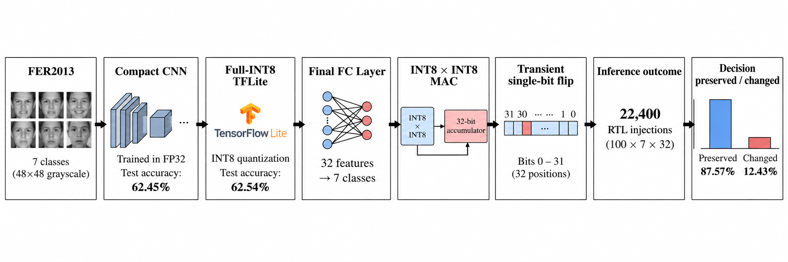
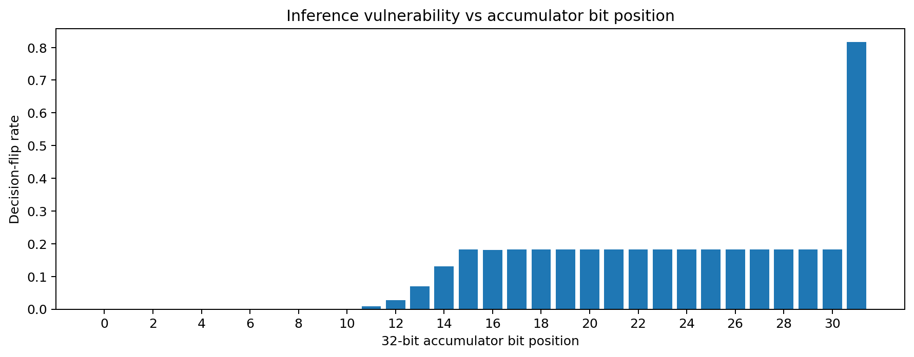
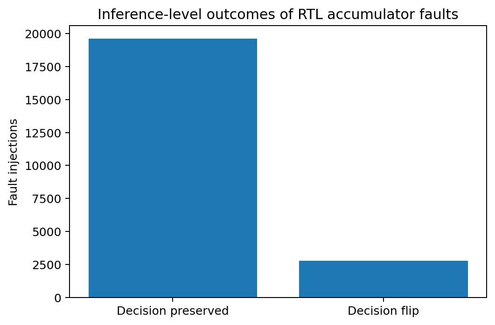
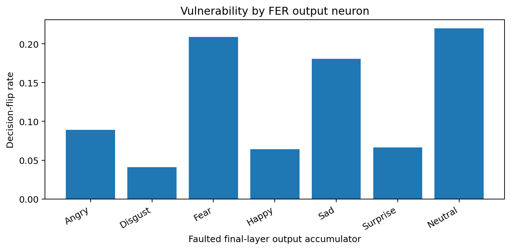

<div align="center">

# TinyFault-FER

### Inference-Aware RTL Fault Injection of an INT8 CNN Accelerator Datapath


**22,400 RTL fault injections · Bit-exact RTL verification · 169.55 MHz synthesized datapath**

</div>

---

**TinyFault-FER** evaluates how transient single-bit faults in a signed 32-bit neural-network accumulator propagate to **inference-level classification failures** in a fully quantized INT8 CNN.

The project connects a deployed quantized neural-network workload to an RTL fault campaign and FPGA synthesis flow, allowing hardware-level arithmetic corruption to be evaluated directly in terms of its effect on the final inference decision.

**Keywords:** RTL fault injection · INT8 CNN · quantized neural networks · AI accelerator reliability · FPGA · TinyML · transient bit flips · accumulator vulnerability · TensorFlow Lite · Icarus Verilog
### Experimental Pipeline

<div align="center">

**FER2013 → Compact CNN → Full-INT8 TFLite → RTL MAC/Accumulator → Bit-Flip Fault Injection → Inference Vulnerability Analysis → FPGA Synthesis**

<br>



</div>

---

## Headline Results

<div align="center">

<table>
<tr>
<th align="left">Metric</th>
<th align="center">Result</th>
</tr>

<tr>
<td>FP32 test accuracy</td>
<td align="center"><b>62.45%</b></td>
</tr>

<tr>
<td>Full-INT8 test accuracy</td>
<td align="center"><b>62.54%</b></td>
</tr>

<tr>
<td>RTL fault injections</td>
<td align="center"><b>22,400</b></td>
</tr>

<tr>
<td>RTL ↔ Python accumulator verification</td>
<td align="center"><b>Bit-exact</b></td>
</tr>

<tr>
<td>Clean reconstruction ↔ TFLite agreement</td>
<td align="center"><b>100%</b></td>
</tr>

<tr>
<td>Overall decision-flip rate</td>
<td align="center"><b>12.43%</b></td>
</tr>

<tr>
<td>Most vulnerable accumulator bit</td>
<td align="center"><b>Bit 31</b></td>
</tr>

<tr>
<td>Bit-31 decision-flip rate</td>
<td align="center"><b>81.71%</b></td>
</tr>

<tr>
<td>FPGA target</td>
<td align="center"><b>Cyclone IV E EP4CE22F17C6</b></td>
</tr>

<tr>
<td>Worst-case registered-datapath Fmax</td>
<td align="center"><b>169.55 MHz</b></td>
</tr>
</table>

</div>

---

## Methodology

### 1. Quantized CNN Workload

A compact convolutional neural network was trained for **7-class facial-expression recognition** and converted to a **full-integer TensorFlow Lite model**.

- FP32 test accuracy: **62.45%**
- Full-INT8 test accuracy: **62.54%**
- INT8–FP32 accuracy difference: **+0.09 percentage points**

The model was intentionally kept compact because the primary objective is **hardware fault analysis**, rather than maximizing facial-expression-recognition accuracy.

The experiment uses the **48 × 48 grayscale FER2013 images** and seven emotion labels exposed by the `abhilash88/fer2013-enhanced` Hugging Face dataset mirror. Additional quality metadata provided by that dataset was **not used as model input**.

Dataset splits used in the experiment:

<div align="center">

<table>
<tr>
<th>Split</th>
<th>Samples</th>
</tr>
<tr>
<td>Train</td>
<td align="center"><b>25,117</b></td>
</tr>
<tr>
<td>Validation</td>
<td align="center"><b>5,380</b></td>
</tr>
<tr>
<td>Test</td>
<td align="center"><b>5,390</b></td>
</tr>
</table>

</div>

### 2. RTL Datapath

The final fully connected classifier of the deployed INT8 model was selected as the RTL fault-analysis target.

The analyzed arithmetic path is:

```text
signed INT8 activation × signed INT8 weight
                    ↓
          signed 16-bit product
                    ↓
          signed 32-bit accumulator
```

The final classifier contains:

```text
32 input features → 7 output neurons
```

Quantized activations, weights, biases, scales, and zero-points were extracted directly from the deployed TFLite model.

Activation zero-point correction was incorporated into the RTL bias term to preserve the intended signed INT8 arithmetic path.

### 3. RTL Verification

The MAC/accumulator was implemented in **SystemVerilog** and simulated using **Icarus Verilog**.

Before fault injection, clean RTL accumulator outputs were compared against the Python integer reference reconstructed from the deployed TFLite tensors.

> **Result: bit-exact Python ↔ RTL accumulator agreement.**

All **100 fault-campaign seeds** also produced clean reconstructed classifier decisions identical to the corresponding deployed TFLite decisions.

> **Clean reconstruction ↔ TFLite agreement: 100%.**

This verification gate ensures that subsequent fault-injection results are evaluated from an integer arithmetic representation consistent with the deployed quantized model.

### 4. Fault-Injection Protocol

A **transient single-bit fault** was injected independently into every position of the signed 32-bit accumulator.

```text
100 inference samples
× 7 output neurons
× 32 accumulator bits
= 22,400 RTL fault injections
```

Each injection modifies one completed output-neuron accumulator before the final classification decision is evaluated.

A fault is defined as **inference-critical** when:

```text
faulty predicted class ≠ clean predicted class
```

This explicitly separates low-level numerical corruption from faults that propagate into an application-level inference failure.

---

## Fault-Injection Results

Across **22,400 RTL fault injections**:

- **12.43%** changed the final predicted class.
- **87.57%** preserved the clean decision.
- Vulnerability varied strongly with accumulator bit position.
- **Bit 31** was the most vulnerable accumulator position.
- Bit-31 corruption produced an **81.71% decision-flip rate**.

### Accumulator-Bit Vulnerability

<div align="center">

</div>

The bit-level results show substantial **fault-significance asymmetry**. Corruption of numerically significant accumulator positions is much more likely to propagate to a classification failure than corruption of lower-impact positions.

### Fault Outcome Distribution

<div align="center">

</div>

Most injected arithmetic faults were masked at the inference level: **87.57%** preserved the original predicted class despite corruption of an accumulator value.

### Output-Neuron Vulnerability

<div align="center">

</div>

The campaign also evaluates how vulnerability varies across the seven final-layer output neurons.

Together, these results demonstrate that:

> **Numerical corruption and inference failure are not equivalent.**

A reliability analysis limited to low-level arithmetic corruption can therefore overestimate the application-level impact of many faults while failing to distinguish the accumulator positions that most strongly affect model decisions.

---

## FPGA Synthesis

The registered MAC datapath was synthesized and analyzed using the same Quartus installation used for the local experiment.

<div align="center">

<table>
<tr>
<th align="left">Configuration</th>
<th align="center">Value</th>
</tr>

<tr>
<td>Tool</td>
<td align="center"><b>Quartus II 13.0 SP1 (64-bit)</b></td>
</tr>

<tr>
<td>FPGA family</td>
<td align="center"><b>Altera Cyclone IV E</b></td>
</tr>

<tr>
<td>Target device</td>
<td align="center"><b>EP4CE22F17C6</b></td>
</tr>

<tr>
<td>Logic elements</td>
<td align="center"><b>64</b></td>
</tr>

<tr>
<td>Registers</td>
<td align="center"><b>64</b></td>
</tr>

<tr>
<td>Embedded multiplier resources</td>
<td align="center"><b>1</b></td>
</tr>

<tr>
<td>Memory bits</td>
<td align="center"><b>0</b></td>
</tr>

<tr>
<td>PLLs</td>
<td align="center"><b>0</b></td>
</tr>

<tr>
<td>Clock constraint</td>
<td align="center"><b>100 MHz</b></td>
</tr>

<tr>
<td>Worst-case setup slack</td>
<td align="center"><b>+4.102 ns</b></td>
</tr>

<tr>
<td>Worst-case hold slack</td>
<td align="center"><b>+0.920 ns</b></td>
</tr>

<tr>
<td>Worst-case registered-datapath Fmax</td>
<td align="center"><b>169.55 MHz</b></td>
</tr>
</table>

</div>

Quartus inferred the signed `INT8 × INT8` multiplication as an embedded multiplier resource.

The reported **169.55 MHz Fmax** corresponds to **static timing analysis of the registered MAC datapath**.

External board-level I/O timing was not modeled, and no physical FPGA deployment was performed.

---

## Experimental Scope

<div align="center">

<table>
<tr>
<th align="left">Component</th>
<th align="center">Scope</th>
</tr>

<tr>
<td>CNN execution</td>
<td align="center">TensorFlow / TensorFlow Lite</td>
</tr>

<tr>
<td>Quantization</td>
<td align="center">Full INT8</td>
</tr>

<tr>
<td>Classifier dimensions</td>
<td align="center">32 features → 7 outputs</td>
</tr>

<tr>
<td>RTL fault target</td>
<td align="center">Final-layer MAC / 32-bit accumulator</td>
</tr>

<tr>
<td>RTL simulator</td>
<td align="center">Icarus Verilog</td>
</tr>

<tr>
<td>Fault model</td>
<td align="center">Transient single-bit accumulator flip</td>
</tr>

<tr>
<td>Fault positions</td>
<td align="center">Bits 0–31</td>
</tr>

<tr>
<td>Validated inference seeds</td>
<td align="center">100</td>
</tr>

<tr>
<td>Total fault injections</td>
<td align="center">22,400</td>
</tr>

<tr>
<td>FPGA analysis</td>
<td align="center">Quartus II synthesis + static timing</td>
</tr>

<tr>
<td>Physical FPGA deployment</td>
<td align="center">Not performed</td>
</tr>
</table>

</div>

TinyFault-FER therefore evaluates a **representative quantized neural-network arithmetic datapath**, rather than claiming a complete CNN RTL implementation.

RTL simulation provides deterministic and repeatable control over fault location while allowing every accumulator bit to be evaluated across thousands of inference scenarios.

---

## Reproducibility

### Repository Structure

```text
TinyFault-FER/
├── README.md
├── LICENSE
├── .gitignore
│
├── notebooks/
│   └── TinyFault_FER_Colab.ipynb
│
├── rtl/
│   ├── int8_mac_accum.sv
│   └── tb_fault_campaign.sv
│
├── quartus/
│   ├── int8_mac_accum.v
│   ├── quartus_top.v
│   ├── tinyfault_mac.qpf
│   ├── tinyfault_mac.qsf
│   ├── tinyfault_mac.sdc
│   └── compile.bat
│
├── results/
│   ├── pipeline.png
│   ├── accumulator_bit_vulnerability.png
│   ├── fault_outcome_distribution.png
│   └── output_neuron_vulnerability.png
│
└── reports/
    ├── rtl_summary.json
    ├── rtl_faults.csv
    └── quartus_resource_summary.txt
```

### Notebook Workflow

The Colab notebook implements the complete experimental pipeline:

1. load the FER2013 workload,
2. train the compact CNN,
3. convert the model to full INT8 TFLite,
4. evaluate FP32 and INT8 accuracy,
5. extract deployed final-layer quantized tensors,
6. reconstruct clean integer accumulators,
7. generate RTL test vectors,
8. execute the Icarus Verilog fault campaign,
9. verify Python ↔ RTL arithmetic,
10. propagate corrupted accumulators to inference decisions,
11. generate vulnerability summaries and figures.

### RTL Simulation

From the `rtl/` directory:

```bash
iverilog -g2012 -Wall \
    -o fault_campaign.vvp \
    int8_mac_accum.sv \
    tb_fault_campaign.sv

vvp fault_campaign.vvp
```

Raw injection-level results:

```text
reports/rtl_faults.csv
```

Frozen RTL campaign summary:

```text
reports/rtl_summary.json
```

### Quartus Synthesis

Quartus version used:

```text
Quartus II 13.0 SP1 (64-bit)
```

Target device:

```text
Altera Cyclone IV E EP4CE22F17C6
```

Compile command:

```bash
quartus_sh --flow compile tinyfault_mac
```

Synthesis/timing summary:

```text
reports/quartus_resource_summary.txt
```

---

## Dataset and References

### Dataset

**FER2013 Enhanced — Hugging Face dataset mirror**

Dataset identifier:

```text
abhilash88/fer2013-enhanced
```

Only the FER2013 **48 × 48 grayscale image pixels and seven expression labels** were used for the CNN workload. Additional metadata supplied by the enhanced mirror was not used as a model feature.

Experimental split sizes:

```text
Train       25,117
Validation   5,380
Test         5,390
```

### Dataset

[FER2013 Enhanced — Hugging Face](https://huggingface.co/datasets/abhilash88/fer2013-enhanced)

### Original FER2013 Reference

I. J. Goodfellow et al.,  
“Challenges in Representation Learning: A Report on Three Machine Learning Contests,”  
*Neural Networks*, vol. 64, pp. 59–63, 2015.  
[DOI: 10.1016/j.neunet.2014.09.005](https://doi.org/10.1016/j.neunet.2014.09.005)

This publication describes the ICML 2013 representation-learning contests, including the facial-expression-recognition challenge associated with FER2013.

---

## Key Takeaway

<div align="center">

### Hardware faults are not equally important at the inference level.

**22,400 faults → 12.43% decision changes**

**Bit 31 → 81.71% decision-flip rate**

</div>

Across the complete RTL fault campaign, most accumulator corruptions did **not** alter the CNN decision, while faults in high-impact accumulator positions—particularly the signed most-significant bit—frequently propagated to classification failures.

TinyFault-FER therefore motivates **inference-aware vulnerability analysis** as a complement to conventional low-level fault analysis when evaluating reliable quantized AI accelerators.
---

## Researcher

**Pritam K Das**  
Email: [preeto.pritam@gmail.com](mailto:preeto.pritam@gmail.com)  
Google Scholar: [Pritam K Das](https://scholar.google.com/citations?hl=en&user=nZ0Ys7EAAAAJ)
